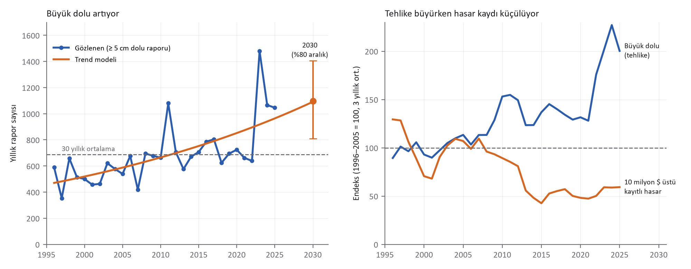

# Dolu Büyüyor, Veri Küçülüyor
*Otuz yıllık açık hava verisiyle iklim hasarını geleceğe taşımak*

*Mehmet Ali Kaya · Veri Yönetimi Uzmanı, Yönetim Bilişim Sistemleri Doktora Adayı, İstatistik Yüksek Lisans*

**ABD'nin otuz yıllık fırtına kayıtlarında 5 santimetreyi aşan dolu her yıl %2,5 artıyor; aynı veri setinin hasar sütunu ise riskin azaldığını söylüyor. Geleceği fiyatlamak isteyen sigortacı, önce hangi sütuna güveneceğine karar vermek zorunda.**

## Veri ve problem

Kullandığım veri, ABD Ulusal Okyanus ve Atmosfer İdaresi'nin (NOAA) kamuya açık Storm Events veritabanı: 1996–2025 arasında kaydedilmiş 1.780.730 hava olayı, bunların 337.858'i dolu raporu. Hasar tutarlarını tüketici fiyat endeksiyle 2025 dolarına taşıdım. Sigortacı için soru basit: Geçmişin ortalamasıyla kurulan bir tarife, 2030'un dolusunu karşılar mı?

İlk bulgu bir uyarı oldu. Veri setinde 10 milyon doları aşan hasar kaydı olan fırtına sayısı yılda %3,2 azalıyor; 1996–2005'te yılda 119, son on yılda 64. Oysa olayların hasar tahmini taşıma oranı %27'den %19'ye düşmüş. Ian Kasırgası bu kayıtta 14,5 milyar dolar görünüyor; NOAA'nın kendi milyar dolarlık afetler listesi aynı fırtınayı 112,9 milyar dolarla anıyor. Riskin azaldığı yok; azalan, hasarın kayda geçirilme oranı.

## Model ve bulgular

Bu yüzden hasar sütununu bırakıp fiziksel tehlikeye, 5 santimetre (2 inç) ve üzeri dolu raporlarına baktım. Bu eşik, ABD'nin 2010'da şiddetli dolu kriterini değiştirmesinden etkilenmiyor. Yıl trendli bir Poisson modeli büyük dolunun yılda %2,5 arttığını gösteriyor (güven aralığı %1,5–%3,5). Rapor sayısındaki genel artışa karşı da sağlam: Tüm dolu raporları içinde büyük dolunun payı %6,0'dan %11,3'e çıkmış.

Modeli zamana karşı sınadım: 1996–2015 verisiyle kurup 2016–2025'i tahmin ettirdim. Trend modeli on yıl için 8.539 büyük dolu raporu bekledi; gerçekleşen 8.525. "Geçmiş tekrar eder" diyen düz ortalama ise 6.071 bekleyip yüzde 29 ıskaladı. 2030 için model yılda ortalama 1.096 büyük dolu raporu öngörüyor (yüzde 80 aralık 808–1.405); bu, otuz yıllık ortalamanın yüzde 59 üzerinde.

| Gösterge | 1996–2005 | 2016–2025 | Model / test |
|---|---|---|---|
| 5 cm üstü dolu raporu (yıllık) | 527 | 852 | yılda +%2,5 |
| Büyük dolunun tüm dolu içindeki payı | %6,0 (2010–14) | %11,3 (2021–25) | neredeyse iki kat |
| 10 milyon $ üstü kayıtlı hasar (yıllık) | 119 | 64 | yılda −%3,2 |
| 2016–2025 büyük dolu toplamı | — | 8.525 gerçekleşen | trend 8.539 · düz 6.071 |

## Geleceğin modelleri

Klasik istatistik, yani bu yazıdaki Poisson trend modeli gibi GLM'ler, açıklanabilir ve denetlenebilir olduğu için tarifenin omurgası olmaya devam edecek. Makine öğrenmesi, poliçe ve bina özelliklerinden riski sıralamada GLM'i geçiyor; derin öğrenme ise radar ve uydu görüntülerinden dolu izini çıkarmada güçlü, ama büyük ve etiketli veri istiyor. Bu çalışmanın asıl dersi ise gri kutu yaklaşımdan geliyor: Fiziksel tehlike ölçüsü (dolunun boyu) ile istatistiksel trendi birleştiren model, hasar kaydı çöktüğünde bile sinyali korudu. Gelecek, tek bir yöntemin değil; fiziksel veri, istatistik ve öğrenen modellerin birbirini denetlediği hibrit yapıların.

## Sektör için tek ders

Geçmiş ortalamayla kalibre edilen bir dolu tarifesi, bu gidişle 2030'da tehlikeyi yüzde 37 eksik görecek. Üstelik hasar verisine körü körüne güvenen bir model, risk artarken "azalıyor" sonucuna varabilir. Türkiye'de dolu kasko, konut ve tarım portföylerinin ortak derdi; bu yüzden hasar kayıtlarının yanında meteorolojik tehlike verisini de tarifeye bağlamak, sigortacılığın geleceği için bir tercih değil, zorunluluk.

## Yarın sabah ne yapmalı?

1. Hasar verisini tehlike verisiyle eşleştirin. Poliçe ve hasar dosyalarını, olay günü ve konumuyla meteorolojik kayıtlara bağlamak, hasar kaydı eksik kaldığında bile riskin yönünü görmeyi sağlar.
2. Tarifeyi ortalamaya değil, trende kalibre edin. Otuz yıllık ortalama, artan bir tehlikede her yıl biraz daha geride kalır; trend katsayısını ve belirsizliğini fiyatlama notuna yazmak bu açığı görünür kılar.
3. Modeli her yıl geleceğe karşı sınayın. Geçmişin bir bölümünü saklayıp modelin onu tahmin edip edemediğine bakmak, tek bir başarı ölçüsünden çok daha dürüst bir kalite kontrolüdür.

## Kod, veri ve model

- Kod: https://github.com/000MAK/cafepolice-climate-losses
- Veri: https://huggingface.co/datasets/makactuary/noaa-storm-events-hail-1996-2025
- Model: https://huggingface.co/makactuary/noaa-hail-trend-2030

*Sınırlılıklar: Veriler ABD'ye ait ve sigortalı hasar değil, ekonomik hasar tahminidir. Dolu raporları gözlemci ve nüfus yoğunluğundan etkilenir; pay analizi bu etkiyi azaltır ama yok etmez. Trendin ne kadarının iklimden, ne kadarının raporlama ve yapılaşmadan geldiği bu veriyle ayrıştırılamaz.*

*Kaynaklar: NOAA NCEI Storm Events Database (1996–2025, kamu malı); NOAA NCEI Billion-Dollar Weather and Climate Disasters; ABD tüketici fiyat endeksi (FRED, CPIAUCSL).*
